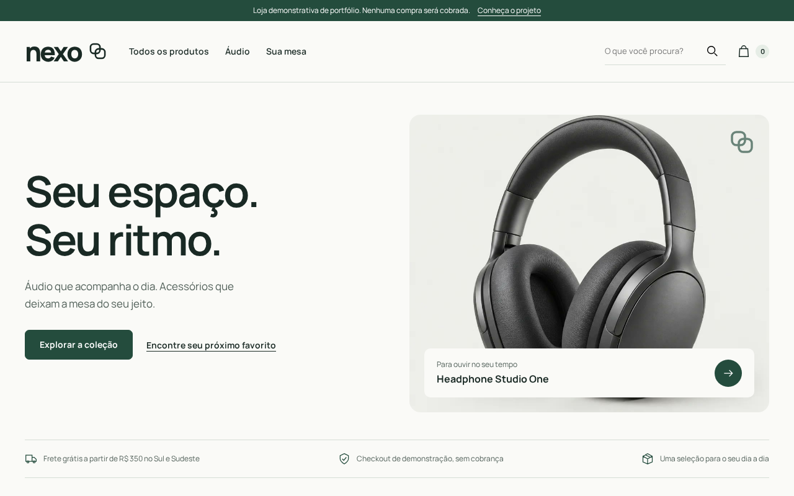
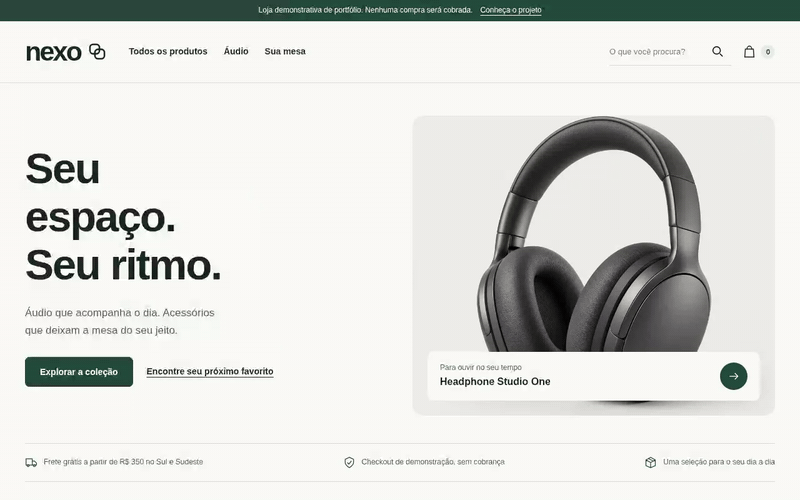
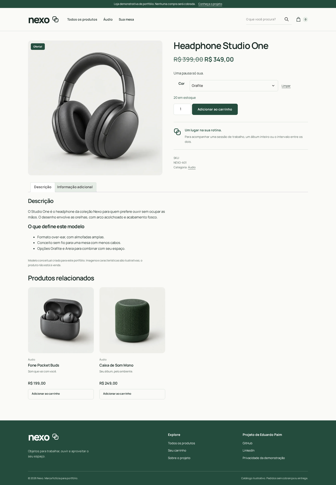
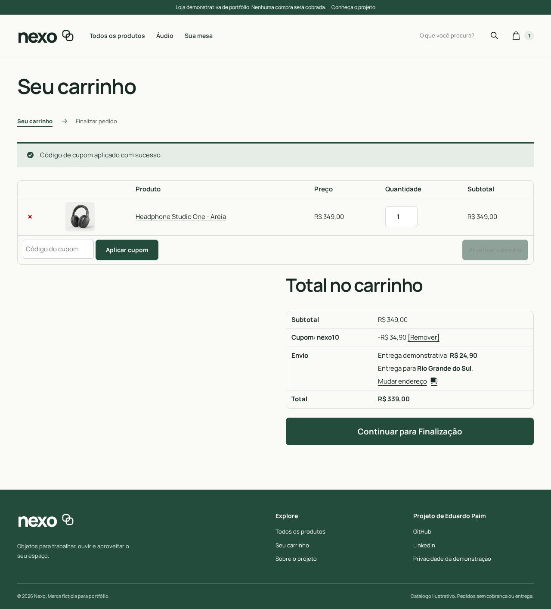
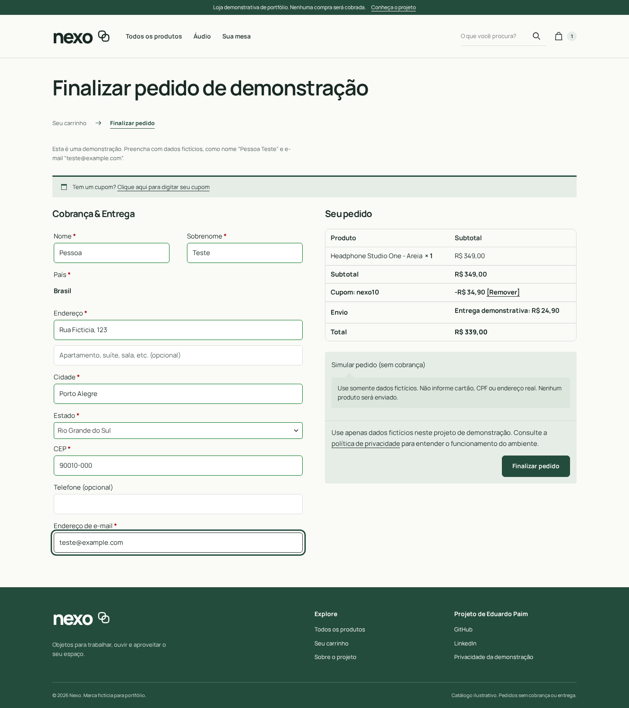
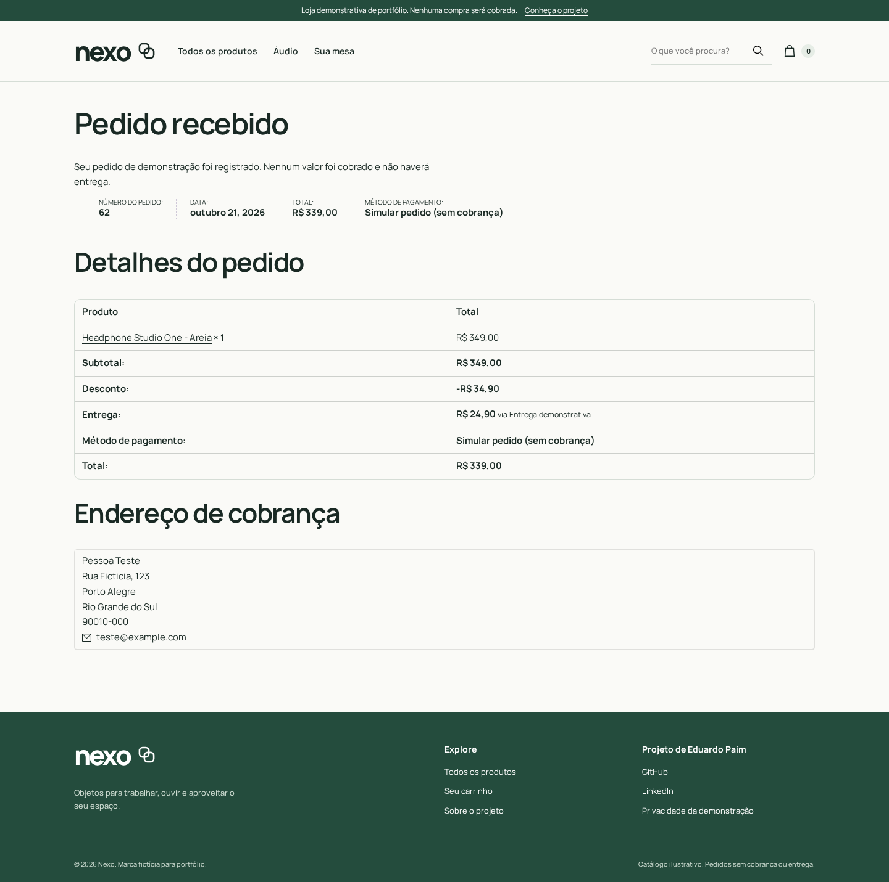
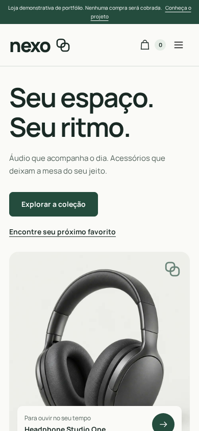
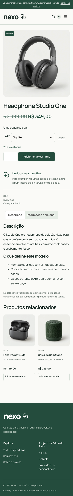
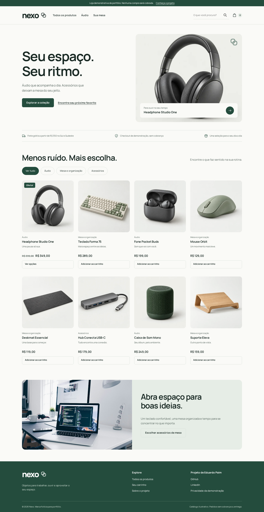

# Nexo | WordPress + WooCommerce


Loja fictícia de acessórios para mesa e áudio. Projeto de portfólio de Eduardo dos Santos Paim, criado com assistência de IA para demonstrar desenvolvimento no ecossistema WordPress. Não representa experiência profissional anterior com WordPress nem uma operação comercial real.

**PHP · WordPress · WooCommerce · MySQL · Docker · Playwright**

O projeto é apresentado neste repositório, sem deploy público. As capturas abaixo mostram o WordPress em execução local, com catálogo e pedidos do WooCommerce. Você pode reproduzir a demonstração com Docker.



## Demonstração visual



| Produto e seleção de cor | Carrinho com cupom |
|---|---|
|  |  |

| Checkout simulado | Confirmação sem cobrança |
|---|---|
|  |  |

<details>
<summary>Ver versão móvel e página inicial completa</summary>

<p> </p>



</details>

As imagens de produto são modelos conceituais gerados com IA para manter a direção de arte da coleção; não representam itens à venda. As capturas da interface e a gravação mostram a aplicação real. No checkout, todos os dados demonstrados são fictícios.

## Pontos para avaliação técnica

- [Tema próprio](theme/): integração com templates e hooks do WooCommerce, identidade responsiva e assets locais.
- [Plugin separado](plugin/nexo-commerce.php): método de entrega configurável pela Shipping Method API e gateway de demonstração.
- [Regra de frete em centavos](plugin/src/ShippingPolicy.php): mínimo após descontos e estados elegíveis, com [testes de fronteira](tests/shipping-policy.php).
- [Teste de integração](scripts/verify-integration.php): tarifas WooCommerce e retentativa do gateway sem redução duplicada de estoque.
- [Teste de navegador](tests/storefront.cjs): busca, categoria, variação, cupom, validação e pedido completo.
- [CI no GitHub Actions](.github/workflows/ci.yml): instalação, testes e evidências do navegador. [Ver execuções](https://github.com/EduardoPaim5/nexo-woocommerce/actions).

Consulte [as verificações e seus limites](QA.md), [os relatórios locais registrados](docs/reports/) e [a direção visual](DESIGN.md).

## Abrir e executar

Pré-requisitos: Docker Engine com Compose, Bash, curl e OpenSSL.

```bash
bash scripts/setup.sh
```

Loja: http://localhost:8092 · Administração: http://localhost:8092/wp-admin/

Usuário local: `eduardo`. A senha é gerada no primeiro setup e fica em `ADMIN_PASSWORD` no arquivo `.env` ignorado pelo Git. Nunca publique esse arquivo. O serviço só expõe a porta na interface local; o banco não expõe portas no host. O setup usa volumes próprios e não toca outros projetos.

O setup instala WordPress/WooCommerce, ativa tema e plugin, popula 8 produtos, duas variações do headphone, páginas, frete e cupom. Reexecutá-lo atualiza os dados demonstrativos sem duplicar produtos por SKU, páginas por slug ou o cupom. Não restaura estoque de pedidos já realizados. As imagens já acompanham o código; o setup exige internet para imagens Docker, WP-CLI, WooCommerce e traduções.

```bash
docker compose stop       # pausa sem apagar dados
docker compose up -d      # retoma
```

## O que funciona

- Tema autoral em PHP/CSS/JavaScript, coleção visual de produtos conceituais gerada por IA e Manrope variável auto-hospedada.
- Identidade Nexo com símbolo de elos, favicon, notas de produto e navegação das etapas do pedido. Descrições específicas diferenciam os oito modelos conceituais.
- Catálogo, categorias, busca, produto com variação de cor e estoque controlados pelo WooCommerce.
- Carrinho nativo, atualização de quantidades, cupom `NEXO10` (10%) e validação do checkout clássico.
- Gateway fictício sem cartão, CPF ou integração bancária. Pedidos ficam “Aguardando”, sem serem declarados pagos. Retentativas do gateway não reduzem estoque duas vezes.
- Plugin com frete configurável por zona, estados elegíveis, mínimo após descontos e tarifa padrão. Defaults: grátis a partir de R$ 350 no Sul/Sudeste; R$ 24,90 nas demais condições no Brasil.
- Bloqueio de e-mails na demonstração, cadastro opcional desativado e avisos para usar dados fictícios.

Configure o frete em **WooCommerce > Configurações > Entrega > Brasil: demonstração > Nexo: frete regional**. O cálculo utiliza a Shipping Method API, com validação da Settings API. A regra não fica acoplada ao tema. Se alterar os valores no painel, atualize também o texto de divulgação da página inicial.

## Arquitetura e escolhas

`theme/` contém o tema Nexo e mantém os templates comerciais do próprio WooCommerce. `plugin/` contém o método de envio, gateway e restrições da demonstração. `plugin/src/ShippingPolicy.php` é uma política pura com valores em centavos e testes de fronteira. `scripts/seed.php` popula dados com as classes CRUD do WooCommerce. `tests/` contém os testes de política, navegador e acessibilidade.

O tema não depende de um tema pai: é um tema clássico próprio e declara suporte ao WooCommerce. CSS/JS são enfileirados pelas APIs WordPress; saídas dinâmicas são escapadas. Não há edição do core nem dos arquivos do WooCommerce. O checkout é **clássico por escolha explícita**; o gateway não implementa integração com Checkout Blocks, e o plugin declara essa incompatibilidade. HPOS é declarado compatível pelo uso das APIs de pedidos.

## Validação reproduzível

PHP CLI 8.1+ para testes puros; Node.js para testes de navegador:

```bash
php tests/shipping-policy.php
npm ci
npx playwright install chromium
npm run test:browser
node tests/accessibility.cjs
docker compose exec -T wordpress php /opt/nexo-runtime/wp-cli.phar --allow-root eval-file /opt/nexo/verify-integration.php
```

O teste de navegador cria um pedido fictício e reduz o estoque de uma variação. Ele testa campos obrigatórios, cupom, seleção de cor, menu móvel, busca, categoria, overflow e checkout. O teste de integração cria e exclui seu próprio pedido e restaura estoque no fim. Capturas e relatórios ficam em `artifacts/`. A auditoria axe é automatizada; não equivale a certificação WCAG ou teste com leitores de tela e dispositivos físicos.

## Roteiro para entrevista

1. Mostre o catálogo no desktop e no celular; explique o tema próprio e a separação das responsabilidades.
2. Abra o headphone e escolha uma cor; confira a variação no carrinho.
3. Aplique `NEXO10` e explique que o frete considera o subtotal após descontos.
4. Use dados fictícios no checkout e finalize sem cobrança.
5. Abra `ShippingPolicy.php`, seus testes de limite e a integração na Shipping Method API.
6. Mostre a configuração de entrega no painel e o gateway idempotente.
7. Explique as limitações: demonstração, checkout clássico, publicação ainda pendente e ausência de testes em navegadores/dispositivos físicos adicionais.

## Distribuição e limites

Esta entrega roda **localmente**. O link deste repositório, com capturas e gravação, é a apresentação pública do projeto. Não há site hospedado nem ambiente de produção. As credenciais são geradas no setup e não são versionadas; banco e uploads ficam em volumes Docker próprios.

Para levar a outra instalação, importe os ZIPs do tema e do plugin pelo painel e execute o seed com WP-CLI. Banco de dados, uploads e configurações do ambiente rodando ficam nos volumes Docker; os ZIPs isolados não são um backup completo.

## Créditos e licenças

Tema e plugin: GPL-2.0-or-later. WordPress e WooCommerce mantêm suas licenças. Fonte Manrope: SIL OFL, arquivo em `theme/assets/OFL.txt`. Imagens de catálogo geradas com imagegen e fotografia editorial Unsplash, conforme `assets/SOURCES.md`. Os prompts estão em `assets/PROMPTS.md`. Produtos, especificações e preços são fictícios.
